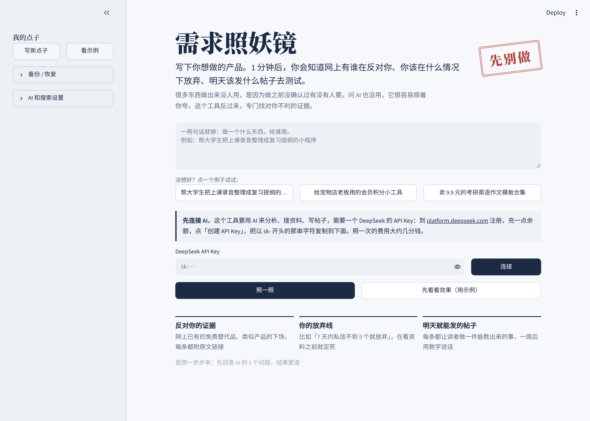
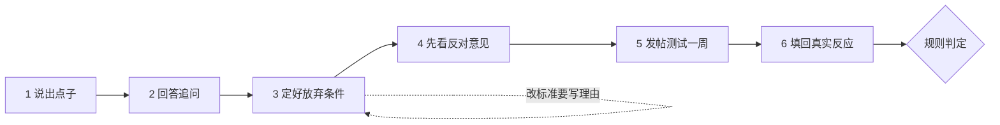
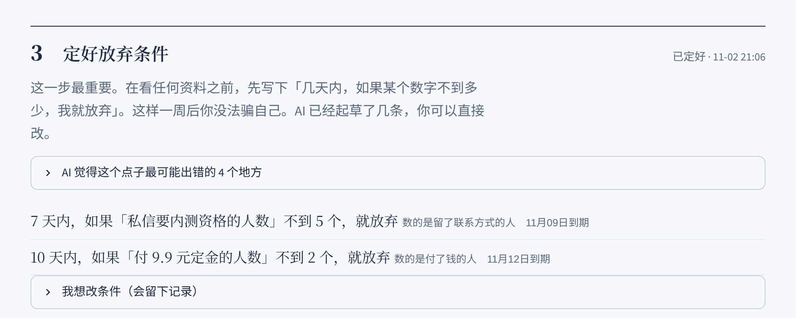
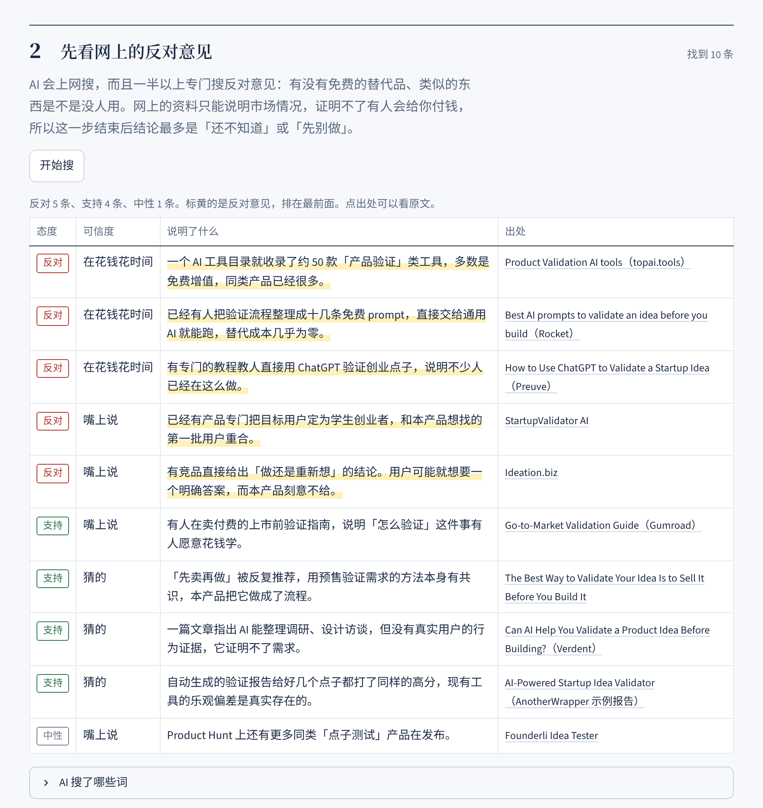
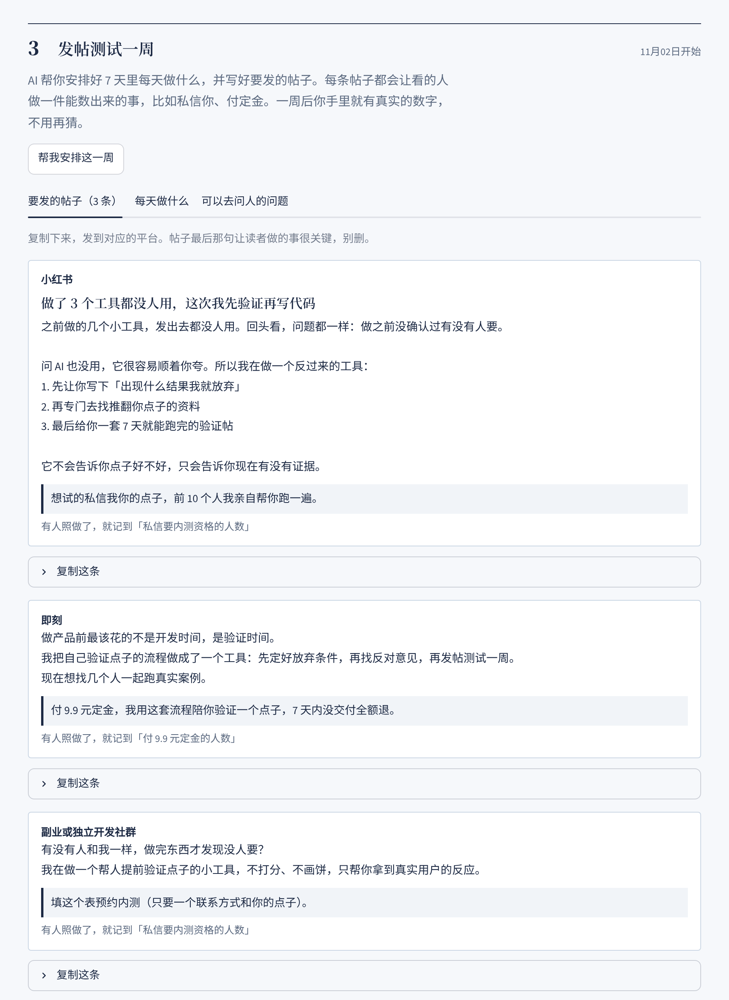
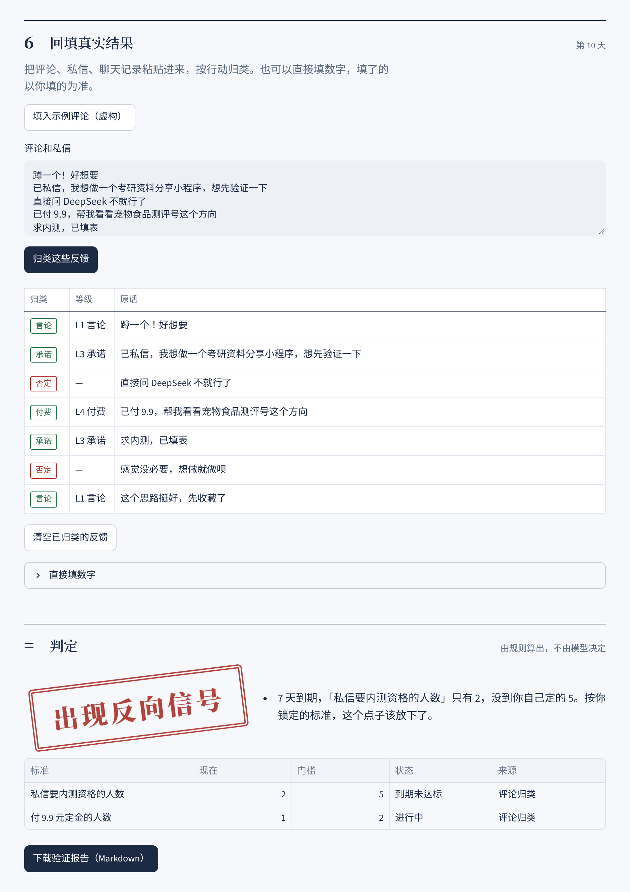

# 先别做 · DontBuildYet

**不预测你的点子行不行，只帮你拿到能推翻它的证据。**

一个给"想做产品、但不知道有没有人要"的人用的验证工具。它不打分、不说"前景广阔"，而是让你先写下放弃条件，再去找反对证据，最后用一周的真实实验拿数据说话。



---

## 为什么做这个

我一直卡在同一个问题上：做出来的东西没人用，因为做之前根本不知道需求在哪。

第一反应是做一个"AI 帮你分析点子有没有需求"的工具。但调研之后发现两个问题：

1. **这类工具已经很多。** 光[一个 AI 工具目录](https://topai.tools/s/product-validation)就收录了约 50 款"产品验证"工具，还有产品[专门瞄准学生创业者](https://www.turbostarter.dev/ideas/ai/startupvalidator-ai)。
2. **它们大多在制造信心，而不是寻找证据。** 有网站用 AI 给各种点子[生成验证报告](https://anotherwrapper.com/tools/startup-idea-validator/ai-powered-startup-idea-validator-unlocking-success-before-you-launch)，结果好几份都是同样的高分。模型天生倾向于顺着用户说，而用户心里也想听"可以做"。

更根本的是：**联网搜索只能说明"市场上有人有这个问题"，永远说明不了"有人会为你付钱"。** 后者只能靠真实用户的行为。

所以这个工具反过来做：它的目标不是帮你下决心，而是帮你尽快发现"该放弃了"。

## 核心思路：证据有等级

| 等级 | 名称 | 例子 | 能从哪里拿到 |
|---|---|---|---|
| 0 | 猜的 | AI 的判断、你自己的感觉 | 任何地方 |
| 1 | 嘴上说 | "好想要""蹲一个" | 搜索、评论区 |
| 2 | 在花钱花时间 | 有人正在为这个问题买竞品、自己拼凑替代方案 | 搜索 |
| 3 | 留了联系方式 | 有人**对你**留联系方式、预约、加群 | **只能靠发帖测试** |
| 4 | 付了钱 | 有人**对你**付钱、付定金 | **只能靠发帖测试** |

结果只有三种状态，没有分数：

- **还不知道**：证据还不够，说明不了任何事
- **先别做**：到期没达到你自己定的放弃条件，或者网上有足够多有分量的反对意见
- **有人愿意付钱**：你定的「有人付钱」条件全部达成

## 流程



| 步骤 | 做什么 | 关键设计 |
|---|---|---|
| 1 说出点子 | 一两句话 | |
| 2 回答追问 | AI 针对你的点子问 3 个问题：给谁用、他们现在怎么解决、为什么是你 | 逼你把"大学生"缩窄成"在闲鱼卖简历模板的大学生" |
| 3 定好放弃条件 | 写下"N 天内某个数字没到 X，我就放弃" | **必须在看任何资料之前定下来**；只能数「留了联系方式」和「付了钱」的人；至少一条付钱的条件 |
| 4 先看反对意见 | 联网搜索并整理成一张资料表 | 至少一半的搜索词专门用来推翻点子；每条证据都带来源链接 |
| 5 发帖测试一周 | 每天做什么、3 条宣传文案、5 个访谈问题 | **可计数的宣传**：每条帖子都带一个能数出来的行动，数据直接记到对应的标准上 |
| 6 填回真实反应 | 粘贴评论和私信，AI 按行动归类；也可以直接填数字 | 按行动归类，不按语气热情程度归类 |

<table>
<tr>
<td></td>
<td></td>
</tr>
<tr>
<td></td>
<td></td>
</tr>
</table>

## 设计决策：模型只归类，判断交给代码

在 prompt 里写"请客观评价"挡不住模型的乐观倾向。所以这个项目里，**大模型只负责起草和归类，所有判断都由确定性的代码完成**，可以复现、可以测试：

| 问题 | 代码怎么处理 | 位置 |
|---|---|---|
| 模型爱打分、爱说"前景广阔" | 输出端的乐观拦截器：分数、成功率、"蓝海""刚需""建议立即开发"等一律替换并计数，侧边栏显示拦截了多少处 | `dby/guard.py` |
| 模型可能编造来源 | 模型只能引用搜索结果的编号，链接由代码填回；引用不存在的编号直接丢弃 | `dby/pipeline.py` |
| 模型可能把搜索资料说成"有人会付钱" | 网上资料的可信度被代码强制压在第 2 级（在花钱花时间）以下 | `dby/models.py` `DESK_RESEARCH_MAX` |
| 看完资料再把标准改成能通过的样子 | 放弃条件不定下来就不能看资料；定下来之后再改必须写理由，降低门槛或延长期限会被标记为"放宽"，写进报告 | `dby/rules.py` |
| 用"好想要"自我安慰 | 放弃条件只能数「留了联系方式」和「付了钱」的人；评论的等级由代码根据标签决定，不由模型决定 | `dby/rules.py` `dby/pipeline.py` |
| "这个点子现在怎么样" | 状态由规则函数 `evaluate()` 计算，不问模型 | `dby/rules.py` |
| 模型只找支持证据 | 反对类搜索词不足一半时，代码自动补足 | `dby/pipeline.py` |

## 我最初没想到的 6 个问题，在产品里怎么处理

做之前我列过这个点子的 6 个风险。这是一个作品集项目，所以我把它们分成"产品机制应对"和"明确不解决"两类：

| 问题 | 处理方式 |
|---|---|
| AI 查资料证明不了需求 | **应对**：不再"预测"，而是生成实验，用「留了联系方式」「付了钱」这种真实行为说话 |
| AI 天生偏乐观 | **应对**：先锁标准 + 乐观拦截 + 代码判定 + 三种状态代替分数 |
| "独特的宣传"是空的 | **应对**：可计数的宣传。宣传本身就是实验，每条都对应一条标准 |
| 国内平台数据很难拿 | **绕开**：不爬平台，让用户粘贴自己收到的评论和私信 |
| 用户只用一次 | **不解决**：作品集不需要留存 |
| 目标用户付费能力弱 | **不解决**：作品集不需要收费 |

## 自我验证：用「先别做」验证「先别做」

演示模式里的案例，就是这个工具本身。完整报告见 [examples/dogfood-report.md](examples/dogfood-report.md)。

**结论：先别做。** 网上找到 3 条有分量的反对意见：同类工具已经很多、有人把验证流程整理成了免费 prompt、有教程教人直接用 ChatGPT 验证。

这不代表一定失败，但意味着实验必须先回答一个问题：**为什么有人会放弃免费的 ChatGPT 来用这个？** 实验方案已经生成，还没跑。跑完后我会把真实数据更新到报告里，不管结果是什么。

> 演示里的"示例评论"是虚构的，只用来展示归类和判定流程。

## 快速开始

需要 Python 3.10 以上。

```bash
git clone https://github.com/Kkk6t/dont-build-yet.git
cd dont-build-yet
pip install -r requirements.txt
streamlit run app.py
```

不填任何 Key 就是**演示模式**，可以完整走一遍流程。

要分析你自己的点子，在侧边栏"模型和搜索设置"里填，或者复制 `.env.example` 为 `.env`：

| 配置 | 说明 |
|---|---|
| `LLM_API_KEY` | 任何 OpenAI 兼容接口都行。默认 DeepSeek，侧边栏也预设了通义千问、Kimi、OpenAI |
| `SEARCH_PROVIDER` | 默认 `DeepSeek`：用 [DeepSeek 官方搜索接口](https://api-docs.deepseek.com/guides/search/)，和对话共用一个 Key。也可以选 `博查`（[open.bochaai.com](https://open.bochaai.com)）或 `Tavily`（[tavily.com](https://tavily.com)） |
| `SEARCH_API_KEY` | 只有选博查或 Tavily 时才需要。不接搜索也能用，只是第 4 步会搜不到资料 |

项目会自动存档到 `data/projects/`，实验跑到第几天回来打开就行。也可以在侧边栏「备份 / 恢复」里下载和上传备份文件。

### 部署到网上

推到 GitHub 后，在 [Streamlit Community Cloud](https://streamlit.io/cloud) 选择这个仓库和 `app.py` 就能免费部署。Key 填在 Cloud 的 Secrets 里，或者不填，直接作为演示站。

## 项目结构

```
app.py              Streamlit 界面
dby/
  models.py         数据模型、证据等级、三种状态
  rules.py          放弃条件、修改记录、判定规则（不依赖模型）
  guard.py          乐观拦截器
  pipeline.py       六个步骤的编排和模型输出校验
  prompts.py        所有 prompt
  llm.py            OpenAI 兼容接口 + 演示模式
  search.py         DeepSeek 官方搜索、博查、Tavily
  report.py         导出 Markdown 报告
  storage.py        项目存档
  demo.py           自我验证案例的演示数据
  ui.py             样式和 HTML 片段
tests/              判定规则、拦截器、流程的单元测试
examples/           自我验证报告
```

## 测试

```bash
pip install -r requirements-dev.txt
pytest
```

测试覆盖的重点是"代码不信任模型"的那些规则：没有付钱条件就定不下来、只靠网上资料永远得不到「有人愿意付钱」、编造的来源会被丢弃、放宽标准会被记录、到期未达标会触发淘汰等。

## 局限

- 归类评论仍然依赖模型，可能归错。所以第 6 步允许直接手填数字，手填的优先。
- 乐观拦截是基于规则的，挡得住常见说法，挡不住换个说法的乐观。
- 搜索质量取决于搜索服务。国内社交平台的内容基本搜不到。
- 判定规则里的阈值（例如"至少 2 条有分量的反对意见"）是我定的，不是什么标准答案。

## License

MIT
